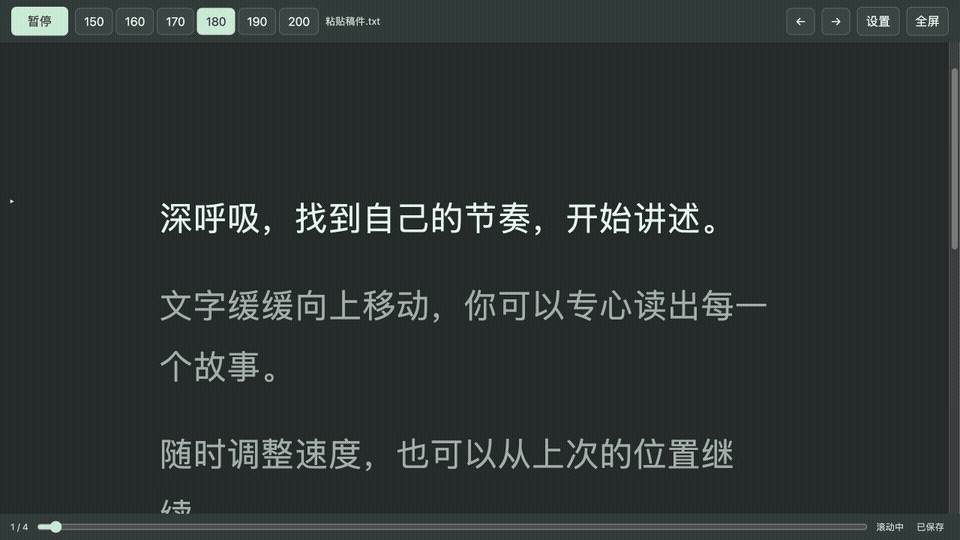
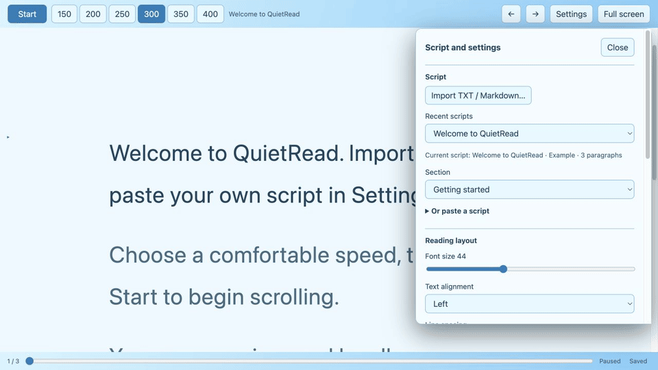

# 轻读提词器 QuietRead

[English](README.md) | 简体中文

QuietRead 是一款适用于 macOS 和 Windows 的离线提词器：它按照可调整的速度滚动稿件，在本地保存阅读位置，并提供英文和简体中文界面。首次启动默认使用英文，可在 **Settings → Appearance and language → Language → 中文** 切换。

## 使用演示

以下无声动图录制自浏览器中真实运行的阅读界面，示例稿件为专门编写的演示文字。桌面应用使用相同的阅读界面。

## 主要功能

- 导入 UTF-8 编码的 TXT、Markdown 文件，或直接粘贴文本。
- 自定义 1–1000 字符/分钟的速度范围，六个按钮均匀分布。例如 100–300 对应 100、140、180、220、260、300。
- 按段落、章节或进度条定位；调整字号、静默倒计时和专注阅读视图。
- 提供十一种界面配色，协调阅读区域、控件与窗口外观；新安装默认使用清爽蓝。
- 可选择正文的字体风格；实际字体由系统提供，缺少时自动使用替代字体。
- 可调整正文对齐方式、行间距和文字宽度，不改变稿件内容。
- 点击设置面板外部即可关闭；有效的速度范围修改会自动应用。
- 在本地保存最近稿件、阅读位置与设置，并提供进度备份恢复和存储错误提示。
- 无需联网、账号或麦克风权限；程序不录音，也不跟踪语音。

## 下载与安装

- **macOS：**[下载 Apple 芯片 Mac 版本](https://github.com/Andrews-Ma/quiet-read/releases/tag/v3.6.0)。需要 macOS 15 或更新版本；解压后将 `QuietRead.app` 拖入“应用程序”。
- **Windows：**[下载 Windows x64 版本](https://github.com/Andrews-Ma/quiet-read/releases/tag/v3.6.0-windows)。需要 64 位 Windows 10 或 11，以及 [Microsoft Edge WebView2 Runtime](https://developer.microsoft.com/microsoft-edge/webview2/)。将 ZIP 内全部文件解压到同一文件夹，打开其中的 `QuietRead.exe`；Windows SmartScreen 可能对下载显示提示。

Windows 包已包含 .NET 运行时，阅读界面使用 WebView2。

## 从源码构建与测试

这部分只针对希望修改源码、自己构建程序的开发者，使用上方下载版本无需执行。构建工具和命令见 [BUILDING.md](docs/BUILDING.md)。

## 稿件与隐私

TXT 按空行分段。Markdown 导入支持常见标题、强调、链接、列表、引用、表格和代码围栏：`#` 标题用于章节导航，不显示在正文中；链接显示文字而不显示网址；完整包裹全文的 Markdown 围栏会去除。文首元数据和 HTML 作为文字保留，导入详情可在设置的稿件信息中查看；粘贴文本也可选择按纯文本或 Markdown 导入。可用 `<!-- CONTENT START -->` 和 `<!-- CONTENT END -->` 标记限定导入内容，也兼容旧版中文内容标记。录音前请检查导入结果。已经保存的稿件不会自动重新解析；重新导入后如果解析结果不同，可能形成单独版本并单独保存进度。

滚动时进度约每两秒保存一次，导航或修改设置后也会保存；突然中断可能丢失最近尚未保存的位置。macOS 应用默认使用 `~/Library/Application Support/QuietRead/Data/`，Windows 应用使用 `%LOCALAPPDATA%/QuietRead/` 下的 WebView2 存储；浏览器版使用各浏览器的独立本地存储。程序不会自行加密这些数据，请自行备份原稿。

## 测试与许可

测试命令及更完整的项目结构参见 [英文 README](README.md)。源码采用 [MIT 许可证](LICENSE)。

Markdown 解析使用 [Marked](https://github.com/markedjs/marked)，其许可见 [MARKED-LICENSE.md](src/web/vendor/MARKED-LICENSE.md)。
